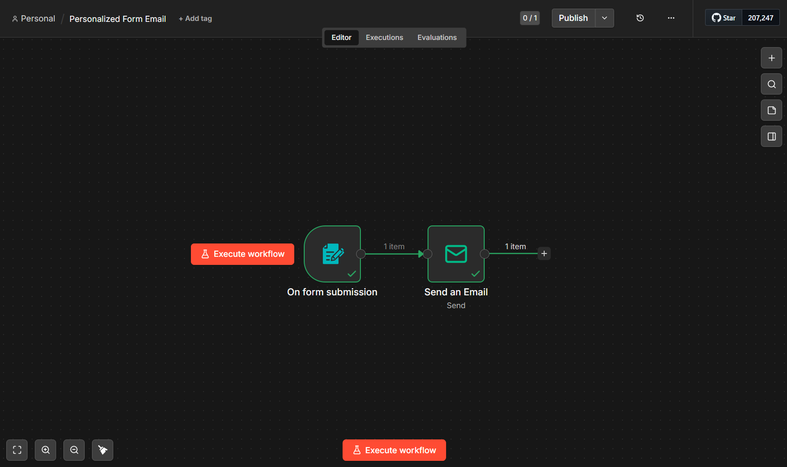

# Personalized Form Email Automation

## Overview
This n8n workflow collects a user's name and email through a form, then sends a personalized welcome email automatically.

## Workflow Architecture
Form Trigger → Send an Email

## Technologies
- n8n
- Email via SMTP
- JSON
- n8n expressions

## Concepts Learned
- Collecting form submissions
- Accessing incoming JSON data
- Using expressions for dynamic values
- Mapping form fields to email fields
- Configuring SMTP credentials
- Testing workflow executions

## How It Works
1. The user submits their name and email through the form.
2. The Form Trigger receives the submission.
3. Expressions retrieve the submitted name and email.
4. The Send an Email node sends a personalized welcome message.

## Testing
Successfully tested the form submission and personalized email delivery.

## How to Run
1. Open your local n8n instance.
2. Import `workflow.json` using the workflow menu's Import from File option.
3. Configure your own SMTP credentials.
4. Check that the form-field expressions match the incoming data.
5. Test with an email address you control.

## Security
Never commit passwords, SMTP credentials, API keys, access tokens, or private user data.

## Screenshots of n8n Workflow 

