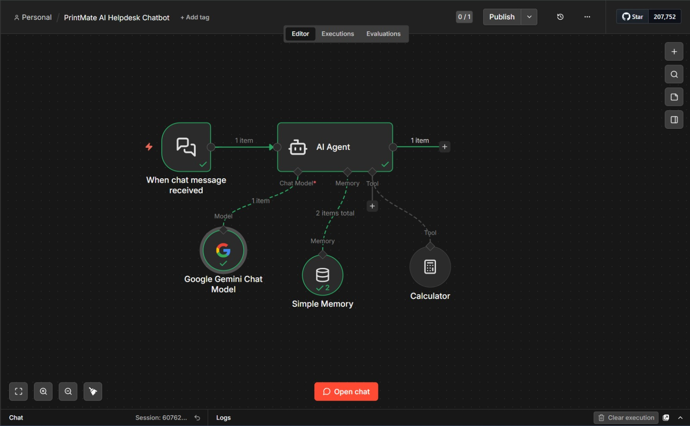
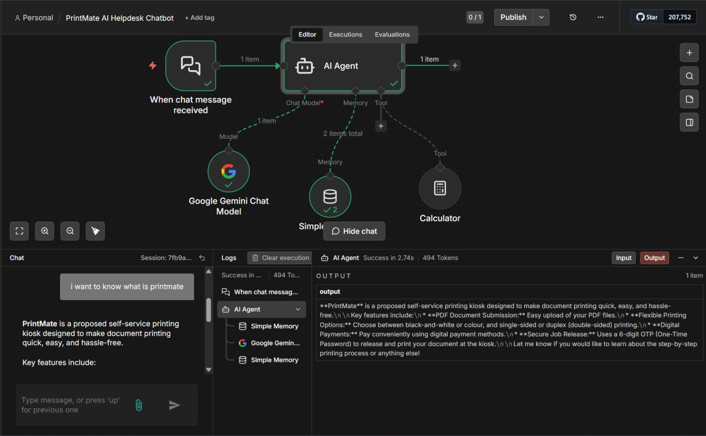

# PrintMate AI Helpdesk Chatbot

An AI-powered support chatbot built with n8n to answer questions about a proposed self-service printing kiosk.

## Features

- Conversational AI using Google Gemini
- System instructions for product support
- Conversation memory using Simple Memory
- Calculator tool for basic calculations
- Guided troubleshooting for common printing problems
- Responses designed to avoid inventing prices or claiming access to live transactions

## Workflow Architecture

Chat Trigger → AI Agent

AI Agent connections:
- Google Gemini Chat Model
- Simple Memory
- Calculator

## Technology Stack

- n8n
- Google Gemini API
- AI Agent
- Simple Memory
- Calculator Tool

## How It Works

1. The chat trigger receives the user's message.
2. The AI Agent interprets the request using its system instructions.
3. Google Gemini generates a response.
4. Simple Memory provides recent conversation context.
5. The Calculator tool can perform calculations when needed.
6. The chatbot returns its response to the user.

## Setup

1. Install or run n8n.
2. Import `workflows/printmate-ai-helpdesk.json`.
3. Configure your own Google Gemini API credential in n8n.
4. Select a Gemini model available to your account.
5. Open the chat interface and test the workflow.

Never commit API keys or exported credentials.

## Testing

Tested scenarios:
- General greeting
- PrintMate product questions
- Conversation memory
- Calculator questions
- Payment-failure guidance
- Requests for live order information

## Current Limitations

- No verified live printer or order-system integration.
- No live payment verification or refund processing.
- PDF page counting and final price calculation are not claimed as implemented unless separately built and tested.
- Persistent production-grade memory and knowledge-base retrieval are future enhancements.

## Future Enhancements

- FAQ knowledge base and document retrieval
- PDF upload and verified page counting
- Configurable printing rates and deterministic quotation calculations
- Request rate limiting and error handling
- React or Next.js chat interface

## Disclaimer

PrintMate is a prototype concept. Responses are informational and do not confirm real-world printer, payment, or order status.

## Screenshot :

